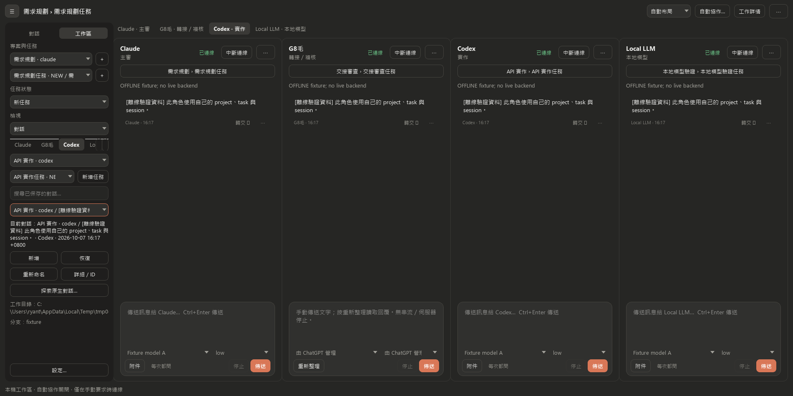

# Independent agent projects and sessions

## Hermes Local role — 2026-10-11

The Local provider now calls Hermes. Existing provider IDs, instance bindings and saved history remain unchanged. Workspace session aliases remain stable while `sessions.metadata.native_session_id` follows Hermes context-compaction changes; explicit resume restores that mapping. Old Local Claude/Codex sessions cannot resume through Hermes. Duplicate control is prevented for the same Workspace alias; external Hermes processes are outside this check. See [HERMES](HERMES.md).

## Dynamic instances — 2026-10-09

The workspace now supports additional Claude, Codex and Local LLM instances through the `+ Agent` control. `acw/agents.py` separates provider type from the generated `agent-<uuid>` routing ID. Built-in IDs remain compatible with existing data. The four built-in entries remain visible; instance removal is not implemented.

Each new instance receives its own disconnected adapter and explicit project/task selection. Its provider settings are copied once; later edits do not change siblings. Auto-discovered CLI paths are runtime defaults rather than persisted instance overrides, so restart can discover updated desktop binaries. No backend session, connection, credential read or prompt is initiated by creating a panel.

Instance definitions are stored in `settings.agents.instances`, configurations in `agent.<id>`, selections in `selection.<id>`, and additional task bindings in `tasks.metadata.agent_sessions`. Existing session/message/event tables use the instance ID in their `agent` field. No DB schema migration is introduced. Drafts remain in-memory; only definitions, settings and bindings survive restart.

Core routes requests, streams, approvals and cancellation by instance. Native sessions are reserved across concurrent resume/send operations by backend family, including Local instances using the same Claude/Codex harness; another connected instance cannot control the same session. This protects the current Workspace only and does not discover an external Desktop process's ownership.

The collaboration dialog accepts separate lead and implementer instances, including two Claude instances. Scope, reply correlation, budgets and approval boundaries remain in force. Parallel multi-worker scheduling, automatic team creation, per-worker worktree isolation and instance removal remain future work. The following sections describe the earlier independent-role foundation.

Implemented against `f9bbe88` on 2026-10-07. The earlier Codex executable discovery repair remains in the same working tree.

## Operator workflow

The Agent sidebar contains one Project selector and one saved Session picker for the selected instance. New conversation creates a separate local history container and native session; Open conversation returns to the saved session's original container. Selecting a saved row alone performs no backend operation. The first explicit send can prepare a fresh conversation without a task form. Explicit Connect restores the currently bound session when one exists; startup never does.

Selecting a project or task changes only that role. Its directory, session mapping, history, draft, attachments and pending approvals follow that selection. Other roles can remain on different projects and continue their active turns. The role being switched must be idle. Changing a project never silently resumes an existing session or sends a prompt.

MainWindow calls `enable_agent_independence()` once during construction. Existing explicit selections are preserved; legacy shared selections are snapshotted into each Agent's existing settings row without adapter I/O. Record-page navigation then changes only record filters: it neither reserves busy independent Agents nor calls their adapters. Task/session tables remain compatible, and ordinary conversation task selectors are hidden. Legacy headless Core clients that do not call this initializer retain the old shared API behavior.

The Claude and Codex desktop conversation navigator opens a conversation into that role's own project/task. Open reservations are per Agent: the same Agent cannot open twice concurrently, while other Agents remain usable. A failed open releases only its own reservation.

## Persistence and routing

Selections use existing SQLite settings rows named `selection.claude`, `selection.dot`, `selection.codex` and `selection.local`. Each stores `project_id` and `task_id`. Session IDs stay in the existing task/session tables. No schema migration or dependency is introduced.

Core connection, new/resume, native discovery/history, prompt/attachment validation and event attribution use the selected role's context. Restart restores selections without connecting or resuming. UI view caches are keyed by role, project, task and session. Git refreshes update only panels using the repository that was inspected.

Handoff previews identify both the source and receiving task/project. Delivery uses the target role's selected task; changing its task or mapped session after preparing the preview requires preparing a new preview.

Automatic collaboration freezes each participant's own project/task/session. Participants may have different containers or projects; the dialog displays their bindings before start. Dispatch contracts and response reads use the receiving Agent's frozen task, not a shared record-page selection. Changing a participant binding pauses the run; changing unrelated record filters does not. Only participating Agents are locked in the workbench. The run's lead conversation holds its orchestration audit events, while individual conversations retain their own prompt/reply history. Shutdown stops the run before asynchronous backend cancellation, preventing a later dispatch while closing.

## Provider limits

Claude, Codex and Local LLM retain their existing backend session capabilities. G8毛's project is workspace metadata; the unofficial Dot integration still requires explicit consent, can resume an existing approved Dot identity, and cannot create a native project or a new Dot conversation. Local LLM retains its selected harness's capabilities.

## Historical verification

Validated 308 tests across the role-context, Core, desktop-session, orchestration, UI, approval, local-provider, Codex/Claude/Dot, discovery, security, inspection and session-label suites: 305 passed and 3 opt-in live tests skipped. Syntax parsing and `git diff --check` passed.



The image uses temporary offline adapters and Windows fonts rendered through Qt's offscreen platform. It demonstrates UI layout and independent selections, not live backend acceptance.

`tests/test_agent_contexts.py` exercises independent contexts for all four roles, own-role idle checks, concurrent event/transcript routing, native discovery/history, attachment scopes, persistence without connection, cross-project resume rejection, target-aware handoffs, draft restoration, desktop Codex opening while Claude is busy, and collaboration with separately frozen bindings. Current verification is recorded in [tests/README](../tests/README.md).

A Codex protocol integration regression uses the real adapter with a labelled in-memory transport and verifies that `thread/start` receives Codex's selected directory and `thread/resume` stays in that project. No live inference or existing user conversation is used by these tests.

Two desktop UI assertions and the default-project assertion now check the role's selection instead of the global selection, matching the new behavior. Existing shared navigation and adapter protocol tests remain active.

Run in PowerShell from the repository root:

```powershell
$env:QT_QPA_PLATFORM = 'offscreen'
$env:PYTHONPATH = 'vendor;tests'
python -m unittest tests.test_agent_contexts tests.test_core tests.test_desktop_sessions tests.test_orchestrator
python -m unittest tests.test_ui_refresh tests.test_approvals tests.test_local_ui tests.test_local_core
python -m unittest tests.test_codex tests.test_claude tests.test_dot tests.test_local_llm tests.test_codex_discovery
```
